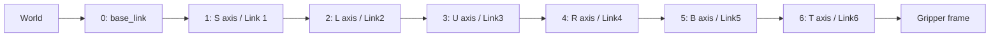

# EN3563 Mini Project: YASKAWA GP7 Pick and Place

## Group details

- Member index numbers: **[add each group member's index number]**
- Simulation: Gazebo Sim with ROS 2
- Robot: YASKAWA MOTOMAN-GP7, six revolute axes

## Objective

Pick up the 5 cm cube (Box B), carry it upright, and place it at the centre of
the top of the 30 cm by 30 cm by 20 cm support (Box A). The simulation uses the
provided GP7 SolidWorks URDF meshes. A small fixed-finger gripper and a
detachable Gazebo joint provide a simple pick/release mechanism.

## Coordinate frames

The world frame has +X to the right, +Y away from the viewer, and +Z upward.
The robot base frame `{0}` is coincident with `base_link` at the robot's
specified origin. Each DH `z` axis lies along the corresponding positive
revolute axis. The `x` axis is the common normal between adjacent joint axes;
`y` completes the right-handed frame.



The ROS `robot_state_publisher` publishes the link frames on TF. The included
RViz configuration displays the robot model, frame axes, and frame names.

## D-H parameter table

The table uses the standard convention

`A_i = Rz(theta_i) Tz(d_i) Tx(a_i) Rx(alpha_i)`.

The parameters below are derived from the joint origins and axes in
`urdf/GP7.urdf`; lengths are in metres and angles in degrees. `theta_offset`
accounts for the SolidWorks exporter frame zero. The final row ends at the
`Link6` origin. A fixed rotation maps the constructed wrist-axis frame to the
CAD `Link6` frame.

| i | GP7 axis / URDF joint | theta offset | d | a | alpha |
|---:|---|---:|---:|---:|---:|
| 1 | S / `joint1` | -112.650760° | 0.330000 | 0.040000 | -90° |
| 2 | L / `Joint2` | -104.091531° | 0.000000 | 0.445000 | 0° |
| 3 | U / `Joint3` | 174.798566° | 0.000000 | 0.040000 | -90° |
| 4 | R / `Join4` | -9.999933° | 0.440000 | 0.000000 | 90° |
| 5 | B / `Join5` | -177.345550° | 0.000000 | 0.000000 | -90° |
| 6 | T / `Joint6` | 0° | -0.058893 | 0.000000 | 0° |

Forward kinematics is the product

`T_0_6(q) = A_1(q_1) A_2(q_2) A_3(q_3) A_4(q_4) A_5(q_5) A_6(q_6) T_6_Link6`.

The fixed `T_6_Link6` rotation is encoded in `gp7robot_description/kinematics.py`.
The module also provides the geometric Jacobian and a limit-aware inverse
kinematics solver.

## Forward and inverse kinematics

The forward transform for each row is

```text
[ cos(theta)  -sin(theta)cos(alpha)   sin(theta)sin(alpha)  a cos(theta) ]
[ sin(theta)   cos(theta)cos(alpha)  -cos(theta)sin(alpha)  a sin(theta) ]
[     0              sin(alpha)             cos(alpha)             d       ]
[     0                   0                     0                  1       ]
```

For a target pose `(p*, R*)`, inverse kinematics uses damped least squares.
The pose error is the concatenation of the translation difference and the
axis-angle vector of `R* R(q)^T`. With geometric Jacobian `J`, the update is

`q_next = clamp(q + J^T (J J^T + lambda^2 I)^-1 e, q_min, q_max)`.

The solver stops when the position error is at most 3 mm and the orientation
error is at most 2 degrees, or reports that no solution was found within the
iteration limit. This is numerical IK; it selects the solution nearest the
previous waypoint seed to keep the arm on a continuous branch.

The URDF joint names and CAD-zero limits are in `kinematics.py`. The supplied
GP7 datasheet gives the physical motion limits as S ±170°, L -65°/+145°,
U -70°/+190°, R ±190°, B ±135°, and T ±360°. The exporter joint zeros do not
match the manufacturer's home zeros, so physical limits must be calibrated to
the model before replacing the CAD-zero limits in a controller.

## Trajectory planning and velocity control

Each joint segment uses a synchronized trapezoidal velocity profile. The
acceleration and deceleration phases are symmetric; the longest joint sets the
segment duration. The controller samples the profile every 20 ms and sends
joint positions and velocities to Gazebo's native joint trajectory controller
through `ros_gz_bridge`.

The demo runs at 15% of the GP7 datasheet's maximum axis speeds, with explicit
acceleration limits in `pick_place.py`. Box B's target orientation is held at
Link6 RPY `(0, 0, 0)` for the approach, pickup, carry, and placement waypoints.
The detachable joint preserves the box's grasp transform during the carry;
the release occurs above Box A, allowing gravity to settle the box onto its
top surface.

## Simulation layout and reachability

The assignment specifies Box A at `(1, 1, 0)` with the robot base at the
origin. That point is `sqrt(1^2 + 1^2) = 1.414 m` from the base in the ground
plane. The GP7 datasheet's maximum horizontal reach is 0.927 m, so the
specified destination is unreachable for this robot at the required base
pose. No inverse-kinematics solver can satisfy both constraints.

Two worlds are included:

- `worlds/gp7_task_spec.sdf` places Box A at the specified `(1, 1, 0)` bottom
  position. The controller detects and reports the reach violation.
- `worlds/gp7_pick_place_reachable.sdf` moves Box A to `(0.55, 0.55, 0)`, a
  horizontal radius of 0.778 m, so the full pick-and-place sequence can be
  demonstrated without changing robot placement. Box B is at `(0.35, 0.25,
  0)`; it can be moved to another reachable ground location using launch
  arguments.

The box model pose uses its geometric centre; therefore a 20 cm tall Box A is
centred at z=0.10 m and a 5 cm Box B is centred at z=0.025 m while resting on
the ground.

## Implementation and results

The launch file starts Gazebo, the robot state publisher, the ROS/Gazebo
bridges, and the GP7 model at the origin. Gazebo's native joint trajectory
controller drives the six joints. The default launch leaves the arm still for
manual joint-by-joint learning. Run `ros2 run gp7robot_description
gp7_pick_place` in another terminal to execute the automated sequence. The
simplified gripper uses two fixed fingers around the 5 cm cube, and Gazebo's
detachable-joint system simulates grasp and release while preserving the
cube's orientation.

The required placement cannot be completed at the exact `(1, 1, 0)` target
because it exceeds the documented reach. The reachable world is provided for
the screen-recorded demonstration. Record the final successful run with the
Gazebo view showing the robot, both boxes, and the full upright transfer.

## Run instructions

From `gp7_ws`, build the ROS 2 workspace and launch the reachable demo:

```bash
source /opt/ros/<your_ros_2_distro>/setup.bash
colcon build --symlink-install
source install/setup.bash
ros2 launch gp7robot_description gazebo_sim.launch.py
```

To load the exact assignment layout, set `world` to the installed
`gp7_task_spec.sdf`; the controller will explain the reachability failure.
The alternate reachable layout can be adjusted through `box_a_x`, `box_a_y`,
`box_b_x`, and `box_b_y` launch arguments, keeping the destination within
0.927 m of the base.

For a frame-labelled view, start RViz in a second terminal:

```bash
ros2 run rviz2 rviz2 -d "$(ros2 pkg prefix gp7robot_description)/share/gp7robot_description/rviz/gp7_frames.rviz"
```

## References

1. EN3563 Robotics Mini Project Task Sheet, supplied as `Task_sheet.pdf`.
2. Yaskawa, *GP7 and GP8 Robots* datasheet, in `Resources-20261116.zip`.
3. Yaskawa, *MOTOMAN-GP7/GP8 Instructions*, Table 5-2, in
   `Resources-20261116.zip`.
4. Gazebo ROS integration, supported ROS/Gazebo message mappings:
   [ros_gz_bridge README](https://github.com/gazebosim/ros_gz/blob/ros2/ros_gz_bridge/README.md).
